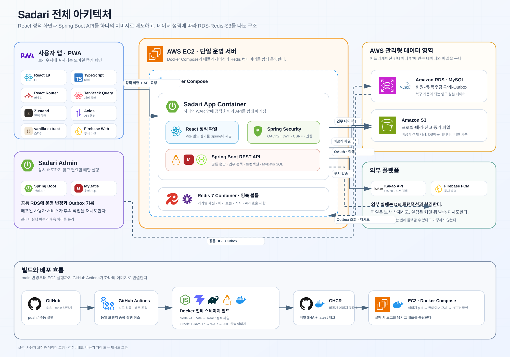

# Sadari

> [독서의 즐거움에 오르다](https://sadaribooks.com/)

Sadari는 독서 기록, 목표, 소셜 활동과 독서 모임을 연결한 React PWA 기반 독서 플랫폼입니다.

## 프로젝트 정보

| 항목 | 내용 |
| --- | --- |
| 개발 기간 | 2026.03 ~ 2026.10 |
| 개발 형태 | 2인 팀 프로젝트 |
| 서비스 구성 | 사용자 React PWA, Spring Boot API, 별도 관리자 서비스 |
| 주요 기여 영역 | 독서 모임 기능의 프론트엔드·백엔드 구현과 사용자 흐름 개선 |
| 배포 구성 | GitHub Actions, GHCR, EC2, Docker Compose |

## 기술 스택

| 구분 | 기술 |
| --- | --- |
| Backend | Java 17, Spring Boot 4.0.3, Spring MVC, Spring Security, MyBatis 4.0.1 |
| Data | MySQL 8.4, Redis 7, HikariCP |
| Auth | Kakao OAuth 2.0, JJWT 0.13, HttpOnly Cookie, CSRF Token, Redis Lua Script |
| Frontend | React 19.2, TypeScript 5.9, Vite 7.3, TanStack Query 5, Zustand 5 |
| Messaging | Firebase Admin SDK, Firebase Cloud Messaging, PWA Push Subscription |
| Storage | Local File Storage, AWS SDK for Java 2.x, Private S3 |
| Delivery | Gradle, Multi-stage Docker, GitHub Actions, GHCR, EC2, Docker Compose |

## 시스템 구성

## 독서 모임 담당 기능

Sadari의 독서 모임 기능을 담당해 모임을 만들고 함께 읽을 사람을 모아 회차별 독서 활동을 이어갈 수 있도록 구현했습니다. 화면 흐름과 서버의 참여·권한 처리를 함께 다룹니다.

### 담당 기능

- 모임 생성, 탐색, 상세 정보 조회와 모임 정보 수정
- 공개·승인제 가입 신청, 초대 및 수락, 모임 탈퇴
- 모임원 관리와 모임장 권한에 따른 관리 기능
- 참여자 프로필 이동
- 함께 읽을 도서 투표, 회차별 목표·독서 기록 및 결과 확인
- 가입·초대·승인 과정의 알림과 모임 상태에 따른 사용자 흐름

### 모임 중심의 화면 흐름

모임 탐색부터 상세 확인, 가입·초대, 멤버 관리, 독서 회차 활동까지 한 모임 안에서 이어지도록 관련 화면과 상호작용을 구현했습니다. 가입 상태와 모임 상태에 따라 사용할 수 있는 기능을 구분합니다.

### 관련 코드

- 백엔드: `src/main/java/org/our/sadari/readingClub/`
- 프론트엔드 화면: `src/main/frontend/src/pages/ReadingClub/`
- 프론트엔드 기능: `src/main/frontend/src/features/ReadingClub/`
